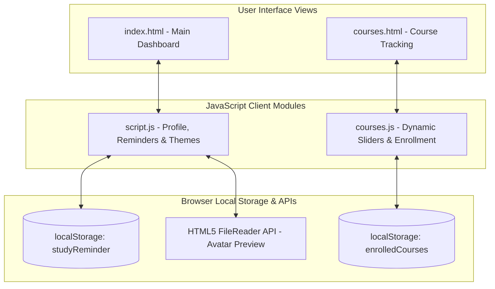

# studentdashboard

[](https://raoabullah.github.io/studentdashboard/)
[](https://developer.mozilla.org/)
[](https://developer.mozilla.org/)
[](https://fontawesome.com/)
[](LICENSE)

**studentdashboard** is an interactive, multi-page web application designed for student learning analytics, course syllabus management, and academic task coordination. Built with vanilla JavaScript, modern semantic HTML5, and responsive CSS3, it offers real-time course progress tracking with dynamic sliders, persistent study notes, custom profile photo uploads, and an instant Light/Dark mode theme engine—entirely client-side with zero backend dependencies.

---

## 📌 Project Overview

Managing multiple university courses, study reminders, and syllabus milestones can quickly become fragmented. **studentdashboard** unifies these student essentials into a clean, intuitive desktop and mobile interface:
1. **Executive Overview (`index.html`):** Displays quick metrics, student profile information, study reminder pads, and navigational shortcuts.
2. **Curriculum Manager (`courses.html`):** An interactive course syllabus tracker where students can add courses, adjust progress via dynamic sliders, and enroll in recommended subjects.

---

## 🏗️ Application Workflow & Architecture



---

## 🌟 Key Features

* **Interactive Course Management (`courses.js`):**
  * **Dynamic Progress Sliders:** Each enrolled course features an interactive range slider (`<input type="range">`) bi-directionally bound to a visual progress bar (`<progress>`).
  * **Live Percentage Updates:** Sliding the progress bar instantly updates the visual fill percentage and updates the course state in real time.
  * **Persistent Enrollment:** Adds recommended courses or custom student-created subjects directly to `localStorage`, persisting changes across browser sessions.
  * **Course Removal:** One-click removal of completed or dropped courses with immediate DOM and storage updates.
* **Instant Light/Dark Theme Switcher:**
  * Toggle between bright and dark color palettes instantly.
  * Smooth CSS transitions across all cards, typography, and action buttons.
* **Study Reminder Pad:**
  * Quick-note notepad for upcoming assignments, exams, or homework deadlines.
  * Persisted in `localStorage` under `studyReminder` with dedicated **Set Reminder** and **Clear Reminder** controls.
* **Real-Time Profile Avatar Upload:**
  * Integrates the browser's native **HTML5 FileReader API**.
  * Converts selected image files into a local Data URL with smooth fade-in opacity transitions for instant profile personalization.
* **Responsive Layout:**
  * Engineered with modern CSS Grid and Flexbox to guarantee fluid responsiveness across mobile phones, tablets, and widescreen desktop monitors.

---

## 📂 Repository File Structure

```text
studentdashboard/
├── index.html         # Main dashboard page (Profile, Reminders, Overview)
├── script.js          # Core controller (Theme toggle, Photo upload, Reminders)
├── courses.html       # Dedicated course progress and enrollment page
├── courses.js         # Course data logic, slider events, and localStorage persistence
├── styles.css         # Complete styling rules, theme variables, and responsive layout
├── profile.png        # Default avatar graphic
└── README.md          # Comprehensive project documentation
```

---

## 🚀 Getting Started

### Prerequisites
* Any modern web browser (Google Chrome, Mozilla Firefox, Microsoft Edge, Safari, Brave).

### 1. Clone the Repository
```bash
git clone https://github.com/RaoAbullah/studentdashboard.git
cd studentdashboard
```

### 2. Run the Application
Open `index.html` directly in your browser:
* Double click `index.html` in your file explorer, or
* Run a local server:
  ```bash
  python -m http.server 8080
  ```
  and visit `http://localhost:8080`.

Or experience the live version directly on GitHub Pages at [raoabullah.github.io/studentdashboard](https://raoabullah.github.io/studentdashboard/).

---

## 👤 Author
* **Rao Abdullah Nasir** — [GitHub](https://github.com/RaoAbullah) · [LinkedIn](https://www.linkedin.com/in/rao-abdullah-rajput) · [Email](mailto:abdullahnasirrao7@gmail.com)
